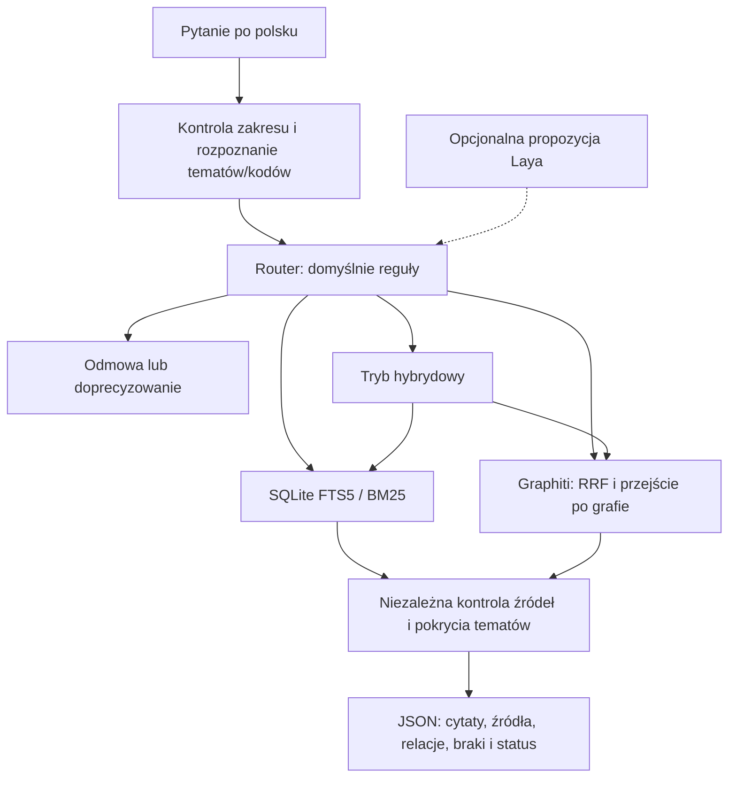

# Machinery Instruction Assistent

**Lokalny asystent dokumentacji technicznej: wyszukiwanie informacji, eksploracja zależności w Graphiti i odpowiedzi w postaci sprawdzalnych fragmentów źródeł.**

Projekt rozwijany pod nazwą roboczą **SLAYER Machine Expert**. Celem jest sprawdzenie, czy dokumentację przemysłową można przeszukiwać i analizować na zwykłym komputerze, na CPU, bez płatnego API i bez wysyłania pytań do zewnętrznego modelu.

**Obecna wersja jest eksperymentem badawczym CLI, nie gotowym systemem diagnostyki lub naprawy maszyn.** Router zwraca źródła i metadane, nie zatwierdzone instrukcje działania. Nie łączy się ze sterownikiem CNC i nie wykonuje poleceń na maszynie.

## Spis treści

- [Co już działa](#co-już-działa)
- [Zakres dokumentacji](#zakres-dokumentacji)
- [Jak działa system](#jak-działa-system)
- [Rola modeli i Graphiti](#rola-modeli-i-graphiti)
- [Szybki start: samo wyszukiwanie](#szybki-start-samo-wyszukiwanie)
- [Uruchomienie Graphiti](#uruchomienie-graphiti)
- [Opcjonalny model decyzyjny Laya](#opcjonalny-model-decyzyjny-laya)
- [Format wyniku i kontrola źródeł](#format-wyniku-i-kontrola-źródeł)
- [Wyniki pomiarów](#wyniki-pomiarów)
- [Testy i odtworzenie eksperymentów](#testy-i-odtworzenie-eksperymentów)
- [Struktura repozytorium](#struktura-repozytorium)
- [Ograniczenia i bezpieczeństwo](#ograniczenia-i-bezpieczeństwo)
- [Źródła i licencje](#źródła-i-licencje)

## Co już działa

- Lokalne wyszukiwanie SQLite FTS5/BM25 z polsko-angielskim słownikiem technicznym i rozpoznawaniem dokładnych kodów, w tym rozróżnieniem `G90` od `G90.1`.
- Rzeczywisty **Graphiti 0.31.2**, lokalna baza **Kuzu 0.11.3**, wektory E5 i przeszukiwanie hybrydowe Graphiti RRF.
- Graf z 56 encjami i 42 ręcznie opracowanymi relacjami, z cytatem i odnośnikiem do źródła przy każdej relacji.
- Przechodzenie po grafie do dwóch kroków, np. od `G53` przez wspólne ograniczenie kompensacji do `G54–G59.3`.
- Router wybierający wyszukiwanie leksykalne, graf, oba mechanizmy albo odmowę/doprecyzowanie pytania.
- Oddzielna kontrola pochodzenia źródeł, ich spójności i pokrycia rozpoznanych tematów.
- Eksperymentalny lokalny klasyfikator Laya, porównany z regułami i **niewłączony domyślnie**.
- Zestawy pytań po polsku, raportowanie JSON i testy regresyjne.

Nie ma obecnie interfejsu WWW, obsługi dowolnego PDF, OCR schematów ani automatycznego dołączania nowych instrukcji. Pliki źródłowe przygotowuje jawny, kontrolowany proces opisany poniżej.

## Zakres dokumentacji

Korpus zawiera **dziewięć wybranych sekcji angielskiej dokumentacji LinuxCNC 2.9.4**, nie kompletną instrukcję obrabiarki:

`G4`, `G17–G19.1`, `G20–G21`, `G53`, `G54–G59.3`, `G61`, `G61.1`, `G90–G91`, `G90.1–G91.1`.

Pytania i materiały ewaluacyjne są po polsku; cytaty pozostają w oryginalnym języku. Źródła wskazują konkretny commit i zakres linii w pliku AsciiDoc. System **nie wymyśla numerów stron PDF**.

Przykładowe pytania:

- „Czy G53 jest modalny?” — bezpośrednie wyszukiwanie sekcji.
- „Z jakimi kodami G53 ma wspólne ograniczenia dotyczące kompensacji promienia frezu?” — graf zależności.
- „Porównaj G53 i G54.” — tryb hybrydowy.
- „Co oznacza E-247?” — odmowa: takiego alarmu nie opisuje dołączony korpus.

Dokumentacja LinuxCNC nie jest podstawą do udzielania instrukcji dotyczących sterowników Haas, FANUC, Siemens czy Heidenhain. Pytania jawnie wskazujące te sterowniki są poza zakresem.

## Jak działa system



### Wybór ścieżki

Reguły korzystają z rodzin kodów opisanych w korpusie i jawnego słownika pojęć. Nie odczytują oczekiwanych odpowiedzi ani identyfikatorów wzorcowych z benchmarku podczas zwykłego pytania.

- **`lexical`** — definicja kodu lub jeden temat. Poza oryginalnym pytaniem wyszukiwane mogą być jawnie rozpoznane kody tematów.
- **`graph`** — relacje i wspólne ograniczenia. Wyszukiwanie semantyczne zachowuje pierwsze trzy różne sekcje źródłowe; przejście po rzeczywistej topologii może dołączyć źródła znalezione do dwóch kroków od rozpoznanych encji.
- **`hybrid`** — porównania i pytania wymagające kilku sekcji. Wyniki obu backendów są łączone, a ich błędy pozostają widoczne.
- **`refuse`** — nieznany kod, inny sterownik, brak danych o konkretnej maszynie, jawne obchodzenie zabezpieczeń albo zbyt nieokreślone pytanie. W ostatnim przypadku wynik żąda doprecyzowania.

To wąska polityka dla tego korpusu, nie uniwersalny klasyfikator bezpieczeństwa. Model decyzyjny nie może ominąć twardych ograniczeń zakresu. Awaria Graphiti nie jest ukrywana przez automatyczne udawanie sukcesu inną ścieżką.

### Graf: co jest ręczne, a co automatyczne

Graf podstawowy pochodzi z pliku `graph_facts.jsonl`: relacje zostały **opracowane ręcznie na podstawie źródeł**. Skrypt sprawdza obecność dosłownego cytatu w odpowiedniej sekcji. To kontrola integralności, nie dowód logicznej poprawności dowolnego wniosku.

Automatyczna ekstrakcja przez Qwen jest oddzielnym eksperymentem, z osobną bazą i raportem. Dotychczasowa próba zakończyła się niepoprawnym/niekompletnym JSON-em relacji. **Nie przedstawiamy ręcznie opracowanego grafu jako udanej automatycznej ekstrakcji.**

## Rola modeli i Graphiti

| Element | Rola w projekcie |
|---|---|
| SQLite FTS5 | Bezpośrednie wyszukiwanie tekstu i kodów; bez modelu ML. |
| Graphiti + Kuzu | Przechowywanie i wyszukiwanie encji, relacji i epizodów; lokalna topologia grafu. |
| `intfloat/multilingual-e5-small` | Rzeczywiste embeddingi CPU, 384 wymiary; pytania po polsku i fakty po angielsku. |
| `Qwen/Qwen2.5-1.5B-Instruct` | Opcjonalna automatyczna ekstrakcja strukturalna; nie generuje odpowiedzi w domyślnym routerze. |
| `convaiinnovations/laya-multilingual` | Eksperymentalny wybór ścieżki, nie ocena prawdziwości odpowiedzi. |
| Slayer1B 1.05 / 1.06 | Oddzielne eksperymenty inferencji, jakości i dostrajania; nieaktywny generator w routerze. |

**Do samego wyszukiwania nie trzeba pobierać Slayer1B ani trenować modelu.** Testy wcześniejszych wersji pokazały, że Slayer potrafił zaprzeczyć dostarczonemu źródłu dotyczącemu modalności G53. Lepsze wyszukiwanie nie naprawia automatycznie tego problemu, dlatego router zwraca wyłącznie materiał dokumentacyjny (`generation_allowed: false`).

## Szybki start: samo wyszukiwanie

Sprawdzone środowisko: **Windows, Python 3.11.9, CPU**. Poniższe polecenia są dla PowerShell. Na innych systemach należy użyć odpowiedniej ścieżki do interpretera; nie deklarujemy przetestowania całej ścieżki instalacji na Linux/macOS.

Wymagane: Git i Python 3.11. Minimalna ścieżka używa biblioteki standardowej Pythona — bez PyTorch, modeli, Docker i klucza API.

```powershell
git clone https://github.com/PiotrStyla/Machinery_Instruction_Assistent.git
cd Machinery_Instruction_Assistent
python -m venv .venv

.venv\Scripts\python.exe scripts\machine_expert.py index
.venv\Scripts\python.exe scripts\machine_router.py ask --question "Czy G53 jest modalny?"
.venv\Scripts\python.exe scripts\machine_router.py ask --question "Co oznacza E-247?"
```

Oryginalne źródła, wyciąg i manifest są w repozytorium. Baza SQLite jest odtwarzana lokalnie i nie jest publikowana. Po sklonowaniu ta ścieżka nie wymaga pobierania dokumentacji z internetu.

Opcjonalne ponowne pobranie tego samego przypiętego wydania:

```powershell
.venv\Scripts\python.exe scripts\fetch_machine_docs.py
.venv\Scripts\python.exe scripts\machine_expert.py index
```

Pobieranie źródeł wymaga sieci. Nie należy podmieniać wyciągu bez zgodnego manifestu: router sprawdza jego sumę SHA256 i rewizję.

## Uruchomienie Graphiti

Wymagane dodatkowo: [uv](https://docs.astral.sh/uv/) oraz miejsce na zależności Python, lokalne modele i bazę grafu. Pierwsza instalacja pakietów, pobranie modeli i instalacja rozszerzenia Kuzu FTS wymagają internetu. Wagi modeli nie są częścią tego repozytorium.

**Na komputerze, gdzie środowisko i graf już istnieją, pomiń ich tworzenie oraz import i przejdź do pytań.** Import nie nadpisuje istniejącej bazy; dla nowej wersji eksperymentu wybierz nową ścieżkę `--db`.

### 1. Oddzielne środowisko

```powershell
uv venv --python 3.11 .venv-graphiti
uv pip install --python .venv-graphiti\Scripts\python.exe -r pyproject.toml --extra graphiti
```

Wersje z `pyproject.toml` izolują stos Graphiti/Transformers od środowiska podstawowej inferencji. Zależności przechodnie nie są zamrożone plikiem lock — nie jest to deklaracja identycznego środowiska na każdym komputerze.

### 2. Jednorazowe pobranie lokalnych modeli

```powershell
.venv-graphiti\Scripts\python.exe -c "from huggingface_hub import snapshot_download; [snapshot_download(repo_id=r, allow_patterns=['*.json','*.safetensors','*.txt','*.model','README.md','LICENSE*']) for r in ('intfloat/multilingual-e5-small','Qwen/Qwen2.5-1.5B-Instruct')]"
```

Obecny konstruktor klienta Graphiti wymaga dostępnego snapshotu Qwen także przy zwykłym wyszukiwaniu. Wagi Qwen są ładowane do obliczeń dopiero podczas ekstrakcji — samo wyszukiwanie nie uruchamia tego generatora. Pobranie wymaga kilku GB miejsca; nie jest to system mieszczący wszystkie zależności w kilkuset MB.

### 3. Zbudowanie grafu

Najpierw wykonaj indeksowanie SQLite z szybkiego startu, następnie:

```powershell
.venv-graphiti\Scripts\python.exe scripts\curate_machine_graph.py
.venv-graphiti\Scripts\python.exe scripts\graphiti_machine.py ingest --install-fts
```

Docelowa baza: `data/machine_expert/graphiti_curated.kuzu`. `--install-fts` służy do jednorazowego przygotowania rozszerzenia; późniejsze komendy tylko je ładują.

### 4. Pytania i eksploracja

```powershell
.venv-graphiti\Scripts\python.exe scripts\machine_router.py ask --question "Z jakimi kodami G53 ma wspólne ograniczenia dotyczące kompensacji promienia frezu?"
.venv-graphiti\Scripts\python.exe scripts\machine_router.py ask --question "Porównaj G53 i G54." --output reports\comparison.json
.venv-graphiti\Scripts\python.exe scripts\graphiti_machine.py neighbors --entity G53 --hops 2 --output reports\neighbors.json
```

Po przygotowaniu lokalnych plików wyszukiwanie i inferencja klientów pracują offline. Klienci ustawiają `HF_HUB_OFFLINE=1`, `TRANSFORMERS_OFFLINE=1` i wyłączają telemetrię Graphiti. Nie jest potrzebny klucz OpenAI ani innego płatnego API.

**Ograniczenie backendu:** Kuzu jest zdeprecjonowany w Graphiti i nie jest utrzymywany upstream. Wybrano go do lokalnego eksperymentu bez serwera i Dockera, nie jako rekomendację produkcyjną. Szczegóły: [eksperyment Graphiti](specs/graphiti_experiment.md).

## Opcjonalny model decyzyjny Laya

Laya jest rzeczywistym lokalnym klasyfikatorem, nie nazwą drugiego zestawu reguł. W obecnym teście wybierał ścieżki gorzej niż reguły i **pozostaje opcją eksperymentalną**.

Po przygotowaniu środowiska Graphiti:

```powershell
uv pip install --python .venv-graphiti\Scripts\python.exe -r pyproject.toml --extra graphiti --extra routing
.venv-graphiti\Scripts\python.exe -c "from huggingface_hub import snapshot_download; snapshot_download(repo_id='convaiinnovations/laya-multilingual')"
.venv-graphiti\Scripts\python.exe scripts\machine_router.py ask --question "Jaką jednostkę długości wybiera G21?" --policy laya
```

Model jest ładowany raz na proces. Pierwsze uruchomienie obejmuje koszt wczytania wag. Przekroczenie budżetu wejścia jest błędem, a nie cichym obcięciem pytania. Prawdopodobieństwa i confidence w raporcie **nie są skalibrowaną pewnością poprawności dla dokumentacji CNC**.

Odmowa wynikająca z twardego ograniczenia zakresu następuje przed ładowaniem Laya. Dotyczy to np. nieznanego alarmu E-247, nawet przy `--policy laya`.

## Format wyniku i kontrola źródeł

Komenda `ask` wypisuje JSON. `--output` zapisuje ten sam wynik do pliku. Najważniejsze pola:

- `rule_decision`, `decision`, `classifier_proposal`: decyzja reguł, decyzja wykonana i ewentualna propozycja modelu.
- `executed_backends`, `lexical_subqueries`, `backend_errors`: faktycznie użyte mechanizmy i ich błędy.
- `evidence.sources`: teksty, sekcje, przypięte URL-e, rewizja i oryginalne numery linii.
- `evidence.relations`: relacje z grafu wraz z cytatami i pochodzeniem.
- `required_sections`, `covered_sections`, `missing_sections`: jawnie rozpoznane tematy i ich pokrycie, wewnątrz `evidence`.
- `evidence.status`, `generation_allowed`, `answer_policy`: stan kontroli i polityka zwracania materiału; dwa ostatnie również wewnątrz `evidence`.

| Status | Znaczenie |
|---|---|
| `target_coverage_complete` | Znaleziono wszystkie jawnie rozpoznane sekcje i nie wykryto błędu ich pochodzenia. |
| `partial_evidence` | Brakuje co najmniej jednej wymaganej sekcji. |
| `no_evidence` / `unscoped_evidence` | Brak źródeł lub brak wystarczająco zidentyfikowanego zakresu. |
| `source_integrity_failed` | Niezgodny tekst/metadane źródła albo niepotwierdzony cytat relacji. |
| `backend_incomplete` | Jeden z wybranych mechanizmów zgłosił błąd. |
| `relationship_evidence_missing` | Ścieżka grafowa nie dostarczyła relacji z wymaganą proweniencją. |
| `refused` / `clarification_required` | Odmowa odpowiedzi lub potrzeba doprecyzowania pytania. |

**Komplet tematów nie oznacza poprawnej odpowiedzi.** Kontrola nie dowodzi, że relacja logicznie wynika z cytatu, że zebrano wszystkie ostrzeżenia ani że instrukcja pasuje do danego egzemplarza maszyny. `generation_allowed` zawsze pozostaje `false`.

## Wyniki pomiarów

Zestaw routera zawiera 24 ręcznie opracowane pytania rozwojowe, po sześć na ścieżkę. Reguły i słownik były rozwijane z użyciem tego zestawu. **To nie jest niezależny benchmark przemysłowy ani wynik certyfikacji bezpieczeństwa.**

| Wybór ścieżki | Poprawne decyzje | Mediana czasu samego selektora |
|---|---:|---:|
| Reguły, domyślne | 24/24 | 0,462 ms |
| Laya, surowa propozycja | 7/24 | 435,208 ms, po załadowaniu |
| Laya z twardymi ograniczeniami zakresu | 12/24 | Nie mierzono osobno |

W tym przebiegu ładowanie klasyfikatora trwało dodatkowo 43,514 s. Czasy selektora nie obejmują wyszukiwania. Użyty snapshot Laya: `052592a15d198d9ad47da779604259b10b47b7aa`; raport zapisuje rzeczywistą lokalizację snapshotu i surowe wyniki modelu.

Przy wykonaniu ścieżek wybranych przez reguły:

- 18 pytań z odpowiednimi źródłami znalazło wszystkie oczekiwane sekcje i przeszło kontrolę pochodzenia/pokrycia tematów;
- pięć otrzymało odmowę, jedno prośbę o doprecyzowanie, bez uruchamiania backendów;
- sprawdzono rzeczywiste wyszukiwanie SQLite, Graphiti i tryb hybrydowy, nie tylko deklaracje etykiet.

Osobny wcześniejszy eksperyment porównywał oba retrievery na 30 pytaniach i czterech pytaniach o zależności. Graphiti nie był lepszy w każdym przypadku; natywne wyszukiwanie samo nie zapewniało odmowy dla pytań spoza zakresu. Szczegółowe wyniki i rozdzielenie importu ręcznego od ekstrakcji automatycznej: [opis Graphiti](specs/graphiti_experiment.md).

## Testy i odtworzenie eksperymentów

Pełny zestaw testów wymaga zależności środowiska Graphiti, w tym PyTorch:

```powershell
.venv-graphiti\Scripts\python.exe -m unittest discover -s tests -v
.venv\Scripts\python.exe scripts\machine_expert.py benchmark
.venv-graphiti\Scripts\python.exe scripts\graphiti_machine.py compare --relationships data\machine_expert\relationship_questions.jsonl
.venv-graphiti\Scripts\python.exe scripts\machine_router.py benchmark --classifier laya --execute
```

Ostatnia komenda wymaga dodatkowo przygotowanej Laya. Porównuje oba selektory, ale wykonuje domyślnie ścieżki reguł. Dodanie `--policy laya` uruchamia ścieżki wybrane przez klasyfikator po zastosowaniu twardych ograniczeń.

Sprawdzone wyniki zestawu testów:

| Środowisko | Zaliczone | Pominięte |
|---|---:|---:|
| Lokalne badawcze, z pobranymi wagami Slayera | 26 | 0 |
| Świeżo wyeksportowany zestaw publikacyjny, bez wag Slayera | 23 | 3 |

Trzy pominięte testy dotyczą cache/inferencji Slayera i wymagają jego wag, których repozytorium nie zawiera. Pozostałe testy obejmują m.in. kody z częścią dziesiętną, jednostki czasu a długości, nieznane alarmy, inny sterownik, pierwszeństwo ograniczeń, brak części źródeł, zmodyfikowany korpus/cytat i błędy backendu. Na świeżym zestawie plików dodatkowo odtworzono indeks SQLite oraz graf z 56 encjami i 42 relacjami i wykonano wszystkie 24 scenariusze routera. Zależności i cache modeli E5/Qwen pochodziły z przygotowanego środowiska tej samej stacji roboczej; nie był to test instalacji na nowym komputerze.

Raporty powstają lokalnie w `reports/`, np. `machine_expert_router.json`. Nie są dołączane do repozytorium: mogą zawierać lokalne ścieżki i surowe wyjścia eksperymentów. To samo dotyczy baz SQLite/Kuzu, cache, wag i środowisk. Udokumentowane wyniki odnoszą się do konkretnego przebiegu, nie do obietnicy identycznych czasów na innym sprzęcie.

## Struktura repozytorium

```text
README.md                         opis i uruchomienie
pyproject.toml                    zależności bazowe i opcjonalne grupy
scripts/
  machine_router.py               wybór ścieżki i kontrola materiału źródłowego
  machine_expert.py               wyszukiwanie SQLite i benchmark bazowy
  graphiti_machine.py             import, wyszukiwanie, graf i ekstrakcja
  local_graphiti_clients.py       lokalni klienci E5/Qwen dla Graphiti
  routing_classifier.py           opcjonalny klasyfikator Laya
  curate_machine_graph.py         jawne, źródłowe relacje grafu
  fetch_machine_docs.py           pobranie przypiętej dokumentacji
  evaluate_machine_expert.py      osobny test zgodności generacji Slayera ze źródłem
  ...                             wcześniejsze eksperymenty inferencji i SFT
data/machine_expert/
  chunks.jsonl                    dziewięć sekcji dokumentacji
  manifest.json                   rewizja, hashe i pochodzenie
  graph_facts.jsonl                ręcznie opracowane relacje z cytatami
  questions.jsonl                 bazowy zestaw pytań
  relationship_questions.jsonl    pytania wieloźródłowe
  router_cases.jsonl              zestaw rozwojowy routingu
  original/                       oryginalne źródła, uznanie autorstwa i licencja
tests/                            testy regresyjne
specs/                            szczegółowe eksperymenty i historia decyzji
```

Repozytorium zachowuje również wcześniejsze skrypty Slayer1B i dane eksperymentalnego SFT. To zaplecze badań, nie aktywny etap domyślnego asystenta. Wagi Slayera, adaptery i pobierany zewnętrzny korpus ewaluacyjny nie są publikowane. Szczegółowy stan prac: [PLAN](specs/PLAN.md).

`.gitattributes` chroni bajty źródeł objętych manifestem przed automatyczną konwersją końców linii w Git. Ma to znaczenie dla sum kontrolnych przy klonowaniu między systemami.

## Ograniczenia i bezpieczeństwo

1. Nie ma połączenia z maszyną, funkcji sterowania ani wykonywania G-code.
2. Dziewięć sekcji LinuxCNC nie zastępuje instrukcji konkretnej maszyny i jej aktualnej rewizji.
3. Wspólna cecha w grafie nie dowodzi związku przyczynowego usterki.
4. Wyszukanie źródła, zgodny cytat i confidence modelu nie stanowią zatwierdzenia porady.
5. Obecny router nie uruchamia generowania odpowiedzi Slayerem. Jego wcześniejsze błędy pozostają udokumentowane.
6. Instalacja jest etapem sieciowym; tryb offline dotyczy późniejszego działania na wcześniej przygotowanych zasobach.
7. Kuzu i niewielki zestaw rozwojowy ograniczają przydatność obecnej konfiguracji produkcyjnej.
8. Obsługa innych instrukcji wymaga sprawdzenia praw do przetwarzania, przygotowania źródeł, grafu, zakresu routingu i niezależnej ewaluacji. Nie wystarczy wskazać ścieżki do dowolnego PDF.

W sprawach napraw, zabezpieczeń i uruchamiania wymagane są zatwierdzone procedury producenta oraz wykwalifikowany personel. Ten projekt jest narzędziem badania dostępu do informacji, nie autoryzacją działań na urządzeniu.

## Źródła i licencje

Dokumentacja pochodzi z [LinuxCNC 2.9.4](https://github.com/LinuxCNC/linuxcnc/commit/b8ccac8f835c0610233fdf799255c63f2b9738ac), commit `b8ccac8f835c0610233fdf799255c63f2b9738ac`.

- Oryginalna dokumentacja: copyright LinuxCNC.org; **GNU Free Documentation License 1.1 lub nowsza**, bez sekcji niezmiennych i tekstów okładek.
- Zachowano [uznanie autorstwa i zgodę](data/machine_expert/original/common/overleaf.adoc) oraz [tekst licencji](data/machine_expert/original/common/gpld-copyright.adoc).
- Korpus jest zmodyfikowanym wyborem sekcji; angielskie fragmenty źródłowe pozostają nieprzetłumaczone. Pochodzenie i sposób ekstrakcji zapisuje manifest.
- Publiczna dostępność cudzej instrukcji, np. Haas, nie oznacza zgody na jej przetwarzanie lub redystrybucję. Takiej instrukcji nie dołączono.
- Modele i biblioteki mają własne licencje; nie są objęte licencją dokumentacji LinuxCNC. Sprawdź ich warunki przed dalszym wykorzystaniem.
- Nie nadano odrębnej licencji kodowi tego repozytorium. Nie należy zakładać, że licencja materiałów LinuxCNC automatycznie licencjonuje cały projekt.

Dalsza dokumentacja: [eksperyment dokumentacyjny i router](specs/machine_expert.md) · [Graphiti](specs/graphiti_experiment.md) · [historia prac](specs/PLAN.md).
