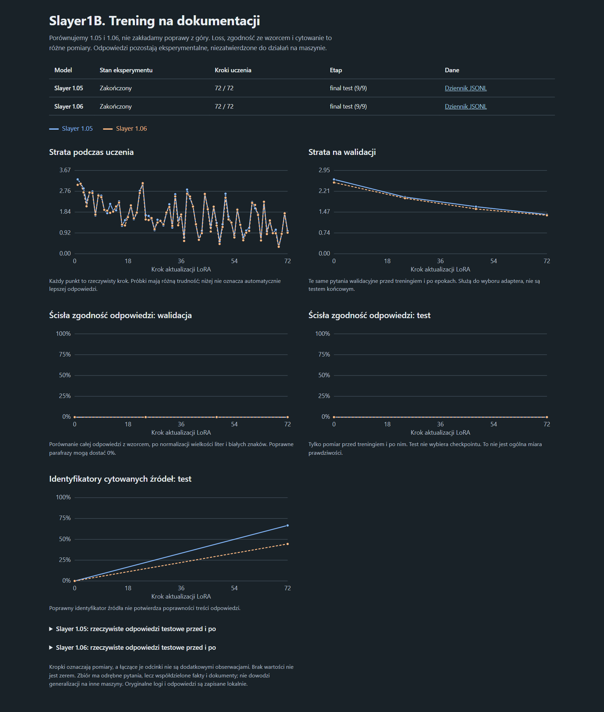

# Slayer1B 1.05 / 1.06 — rzeczywisty trening i wyniki

**Przebieg zakończony 7 listopada 2026 r. Nie wykazano niezawodności odpowiedzi technicznych.** Spadły loss walidacyjny i testowy, ale ścisła zgodność odpowiedzi testowych ze wzorcem pozostała zerowa. Wzrost zgodności identyfikatorów cytatów nie oznacza zgodności treści ze źródłem. W zapisanych odpowiedziach występują niepełne definicje i sprzeczności.

## Co zrobiono

Dwa oryginalne modele dostrojono oddzielnymi adapterami LoRA, lokalnie na CPU, bez płatnego API. Każdy ukończył trzy epoki i 72 kroki. Baza pozostała zamrożona; uczono 158 384 parametry adaptera. Checkpoint wybierała strata walidacyjna, nie wynik testu. Cały przebieg trwał około 3 godz. 29 min.

[Pełny protokół, środowisko, dane, tabela wyników i konkretne błędy](../../specs/grounded_sft.md#observed-first-run-2026-11-07).

Pytania między zbiorami są rozłączne, ale wszystkie korzystają z tych samych dziewięciu sekcji LinuxCNC i współdzielą wiele faktów. Część przykładów opracował asystent AI; nie przeprowadzono niezależnej walidacji eksperckiej. Ocena generacji dostarczała modelowi komplet właściwych źródeł, więc nie jest to miara jakości wyszukiwania Graphiti ani generalizacji na inne maszyny.

## Wykresy



Obraz to zrzut faktycznie wyrenderowanego [panelu HTML](dashboard.html), wygenerowanego wyłącznie z dołączonych logów. Punkty testowe to pomiar bazowy i końcowy, bez dorabiania wartości pośrednich. Ścisłe dopasowanie pełnej odpowiedzi może odrzucić poprawną parafrazę; zapisane błędy nie sprowadzają się jednak tylko do różnic w sformułowaniu.

GitHub pokazuje HTML jako plik, nie aplikację. Pobierz repozytorium przez **Code → Download ZIP**, rozpakuj i otwórz `results/grounded-sft-2026-11-07/dashboard.html` w przeglądarce. Panel działa bez modeli, instalacji pakietów i zewnętrznych usług; można rozwinąć rzeczywiste odpowiedzi przed/po.

## Dane do samodzielnej kontroli

- [Zbiorcze wyniki i wybrane checkpointy](summary.json).
- [Konfiguracja przebiegu i hashe zbiorów](run.json).
- Dzienniki wszystkich aktualizacji: [1.05](1.05/metrics.jsonl), [1.06](1.06/metrics.jsonl).
- Rzeczywiste odpowiedzi testowe przed treningiem: [1.05](1.05/baseline-test.jsonl), [1.06](1.06/baseline-test.jsonl).
- Rzeczywiste odpowiedzi po treningu: [1.05](1.05/final-test.jsonl), [1.06](1.06/final-test.jsonl).
- Podkatalogi wersji zawierają także wszystkie pomiary walidacyjne i ich podsumowania.
- Uruchomienie obu adapterów przez router: [1.05](router_1.05.json), [1.06](router_1.06.json).
- [Rzeczywista ścieżka Graphiti + wyszukiwanie + wytrenowany Slayer](router_graphiti_1.05.json): źródła znaleziono, lecz model zwrócił tylko `G53` zamiast porównania.
- [Opis eksportu i SHA-256 plików](publication.json).

W eksporcie zmieniono wyłącznie absolutne ścieżki katalogu projektu na względne. Liczby, znaczniki czasu, pytania, odpowiedzi i źródła nie zostały poprawione ani zastąpione. Oryginalne raporty pozostały lokalnie. Wagi, adaptery, bazy i środowiska nie są publikowane; względna ścieżka checkpointu w raporcie opisuje artefakt lokalny, nie dołączony plik.

## Odtworzenie panelu

Z katalogu projektu, samym Pythonem:

```powershell
python scripts/plot_machine_training.py --root results/grounded-sft-2026-11-07 --output reports/published_training_dashboard.html
```

To odtwarza wizualizację istniejących pomiarów, nie uruchamia treningu. Instrukcje powtórzenia treningu na nowych katalogach wyników znajdują się w [protokole](../../specs/grounded_sft.md#execute-the-controlled-run).

## Źródła i bezpieczeństwo

Cytaty pochodzą z dokumentacji LinuxCNC 2.9.4 przypiętej do commita `b8ccac8f835c0610233fdf799255c63f2b9738ac`. Warunki GNU FDL 1.1-or-later, atrybucję i oryginalne pliki zachowano w [korpusie](../../data/machine_expert/original/) oraz [opisie źródeł](../../specs/machine_expert.md#source-and-reuse-conditions). Nie usuwać tych informacji przy redystrybucji.

Wynik modelu pozostaje `generated_unverified`. Kontrola źródeł nie potwierdza poprawności wnioskowania. Domyślny router nadal zwraca źródła, nie zatwierdzoną poradę dotyczącą uruchamiania lub naprawy maszyny.
